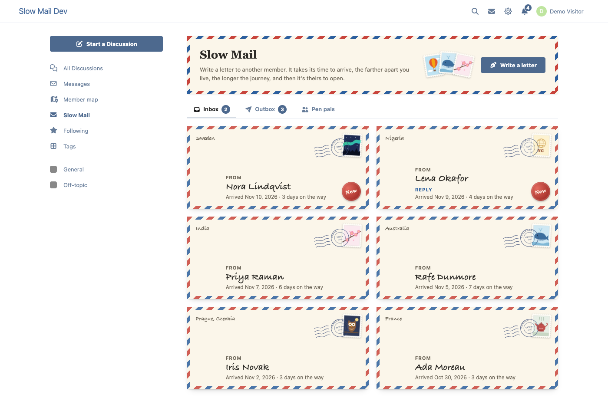
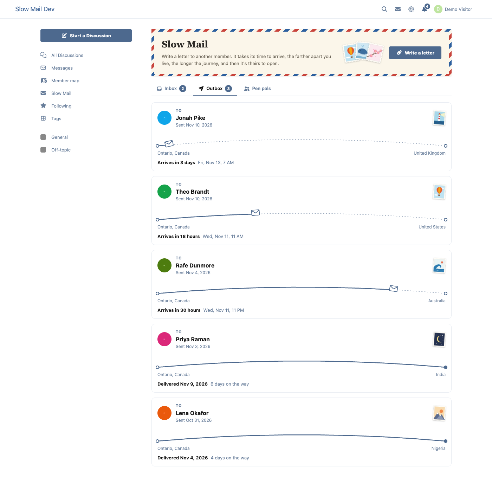
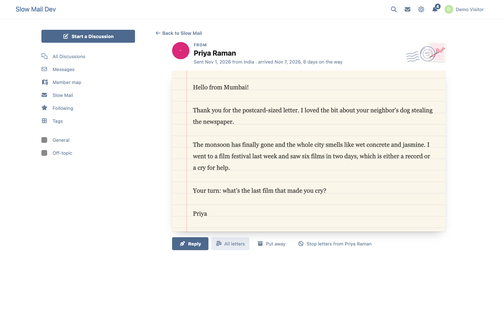

# Slow Mail

Pen-pal letters between members of a [Flarum](https://flarum.org) 2 forum that take time to arrive. The farther apart two members live, the longer the journey: a letter from Lagos to Ontario takes about four days, one across town still takes half a day. Then it's theirs to open.



## What members get

- **Write a letter** to any member, from the Slow Mail page, a pen pal, or "Write a letter" on their profile. Choose a stamp from an original set (a lighthouse, a whale, northern lights, a teapot…, or a "home" stamp with your own country), write, send.
- **The journey.** With [Member Map](https://github.com/ernestdefoe/member-map), the time comes from the distance between the two members' places (the admin sets the speed, a minimum and a maximum). Without it, or when either isn't on the map, a set time.
- **Envelopes** with a postmark from the sender's country or region (never a city), the stamp they chose and the date it was sent.
- **Outbox**: every letter on its way, drawn as a little journey with an ETA. "Delivered" when it gets there.
- **Inbox**: envelopes that have arrived. The first time you open one, the flap lifts and the letter slides out.
- **Reply** to keep a correspondence going: the reply makes its own journey.
- **Pen pals**: everyone you've exchanged letters with, and every letter between you.
- **Looking for a pen pal**: opt in with your interests and where you'd like them to live (anywhere, your country, your continent, another continent), and get matches, best first.
- **Notifications** only when a letter arrives ("A letter from Lena has arrived"), never before. Senders get "delivered".



## Private, really

- Letters are between two members. They're **encrypted** before they're saved, with a key kept in `storage/slow-mail/` and never in the database, and there's no admin view of them.
- A letter on its way **doesn't exist** for its recipient: not in any page, API answer, search or notification until it arrives.
- **Travel times can't give away where someone lives.** A distance is only used when each member can already see the other on Member Map, at the precision each chose (city, region or country). It's then rounded to a band hundreds of kilometers wide and jittered by up to a band either way, the same every time for the same two places, so sending again doesn't help. The tests check that any travel time fits at least two whole bands of distances.
- **Blocks are respected** both ways (Slow Mail's own, and Parley's), and so are "who can send me letters" (everyone, only people who've had a letter from me, nobody), fof/byobu's "block private discussions", Parley's "who can message me" and flarum/messages. A refusal never says which.
- **Rate limits**: letters a day, new people a day (where spam comes from), letters on their way.
- **GDPR** (flarum/gdpr): a member's own export has their letters; a moderator's export of them has counts and dates only. Erasure removes every letter they wrote or got.



## Install

```sh
composer require ernestdefoe/slow-mail
php flarum migrate
php flarum cache:clear
```

Letters are delivered by Flarum's scheduler every minute. On forums without it, they're delivered on the next visit after they're due.

**Back up `storage/slow-mail/`** along with your database: without its key, letters can't be read.

Settings: speed (km a day), shortest and longest journey, the journey without Member Map, letters a day, new people a day, and the sidebar link. Permission: "Write and receive Slow Mail letters" (members by default).

## Links

- [Packagist](https://packagist.org/packages/ernestdefoe/slow-mail)
- [Support](https://ernestdefoe.online)
- ☕ [Buy me a coffee](https://buymeacoffee.com/ernestdefoe)

MIT licensed.
